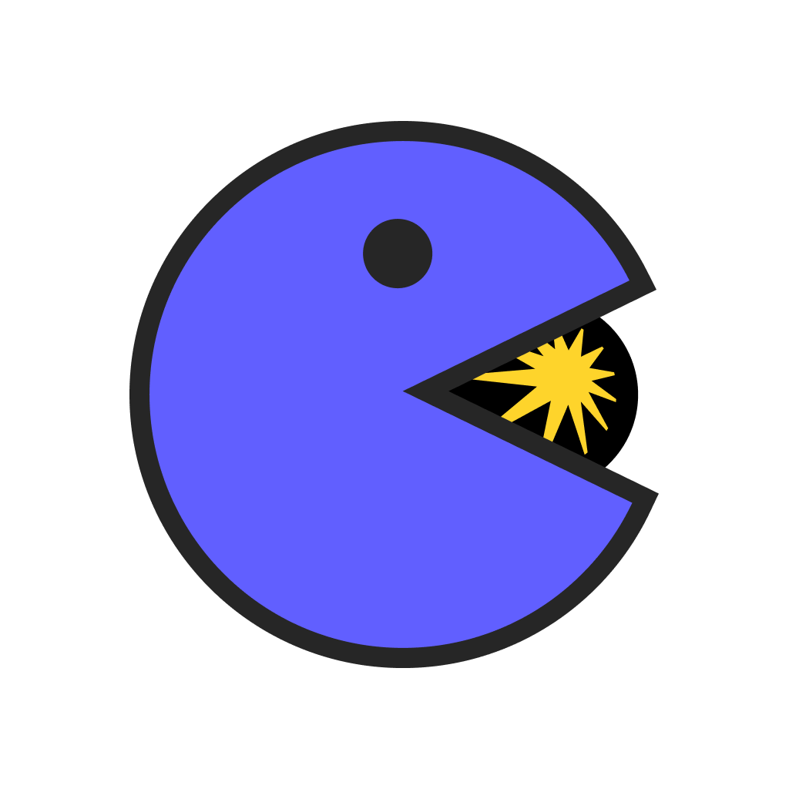

<p align="center">
  
</p>

<h1 align="center" style="font-weight: 800; border-bottom: none; margin-bottom: 10px;">BetterYandexMusic</h1>

<p align="center" style="font-size: 1.2em; color: #8b949e; margin-top: 0;">
  Прокачай свою Яндекс Музыку: совместное прослушивание, новые темы, тексты песен и многое другое.
</p>

<p align="center">
  
  <a href="../../releases"></a>
  
  
  
  
  
</p>

---

## 📥 Скачать (Releases)

Готовые версии (билды) проекта автоматически собираются и доступны на вкладке **[Releases](../../releases)**:
* 📦 **`yandex-music-sync-extension.zip`** — готовое расширение для быстрой установки в браузер (Chrome, Edge, Яндекс Браузер).
* 🖥 **`yandex-music-sync-desktop.zip`** — утилита (патчер) для интеграции в официальное десктопное приложение Яндекс Музыки.

---

BetterYandexMusic расширяет возможности Яндекс Музыки. Проект добавляет функции совместного прослушивания, кастомизации интерфейса, отображения текстов и перевода песен, скробблинга, интеграции с RZT и SoundCloud. Панель управления удобно интегрируется в левый сайдбар.

---

## Ключевые возможности

### 🌊 Несколько режимов «Моей волны» (Кастомизация Главной) — *новое в v1.4*
Возможность гибко настроить внешний вид главной страницы под свои предпочтения в настройках BetterYandexMusic:
* **Режим 1: По умолчанию (`default`)** — стандартный интерфейс Яндекс Музыки с нативной 3D-каруселью станций Моей волны.
* **Режим 2: Без карусели / компактный вид (`no_wheel`)** — минималистичный вид: визуализатор Моей волны разворачивается на всю ширину страницы и плавно заходит под прозрачный левый навбар. Управление волной осуществляется через аккуратную кнопку «Настройка волны» с удобным меню по категориям (*Все, Настроение, Жанры, Артисты, Характер*).
* **Режим 3: Моя волна с лентой рекомендаций (`vibe_with_landing`)** — гибридный режим: полноэкранный плеер Моей волны сверху, а при скролле вниз — лента персональных рекомендаций со страницы «Для вас и тренды» (новинки, AI-сеты, чарты, миксы и любимые плейлисты).

> [!NOTE]
> Режим 3 активно развивается. Если при определенных условиях блок рекомендаций временно не отображается, достаточно перейти на нативную страницу «Для вас и тренды» (`/landing/main`).

---

### 💾 Скачивание треков и целых альбомов — *новое в v1.4*
Встроенный полнофункциональный загрузчик музыки:
* **Скачивание треков в 1 клик:** Кнопка скачивания доступна прямо в строке треков, чартах и через контекстное меню.
* **Скачивание целых альбомов и плейлистов:** Скачивание всех композиций с автоматической упаковкой в единый `.zip`-архив.
* **Выбор качества аудио:** В настройках можно выбрать формат сохранения — **FLAC Lossless** (несжатый оригинальный звук студийного качества) или **MP3 320 kbps** (высокое качество с экономией места).
* **Управление очередями загрузок:** Плавающий компактный боковой виджет (Edge Dock Drawer) с отображением прогресса и статуса каждого трека.
* **Интеграция с системой (для десктопной версии Electron):** Возможность выбрать собственную папку для сохранения музыки и опция автоматического открытия файла/папки в Проводнике Windows или macOS Finder сразу после завершения скачивания.

---

### 🔄 Синхронизация песни
Трансляция действий (воспроизведение, пауза, перемотка времени, переключение треков).
<p align="center" style="margin-top: 15px;">
  
</p>


### 🎨 Переключение темы
Изменение оформления через встроенные пресеты или конструктор «Своя тема».
<p align="center" style="margin-top: 15px;">
  
</p>

---

### 🎧 Выбор качества песни
Управление битрейтом и качеством воспроизводимого аудио из интерфейса.
<p align="center" style="margin-top: 15px;">
  
</p>

---

### 🌐 Перевод песни
Встроенный переводчик с поддержкой полноэкранного режима.
<p align="center" style="margin-top: 15px;">
  
</p>

---

### 🎤 Текст для песен (без официального текста)
Отображение текстов песен из внешних баз для треков, у которых нет текста в Яндекс Музыке.
<p align="center" style="margin-top: 15px;">
  
</p>

---

### 🧠 Интеграция с Genius (Аннотации и тексты)
Полноэкранный плеер с поддержкой текстов от Genius. Позволяет не только читать текст, но и просматривать уникальные аннотации и факты о строчках песен прямо во время прослушивания.

---

### ⏳ Таймер сна (Sleep Timer)
Возможность задать время, через которое музыка плавно и постепенно остановится. Громкость будет затухать медленно, чтобы вы не проснулись от резкого выключения.

---

### 🎵 Скробблинг (Last.fm / ListenBrainz)
Автоматическая отправка прослушанных треков в профили Last.fm и ListenBrainz.
* Настройка прямо на странице настроек Яндекс Музыки (в разделе «Скроблинг»).

---

### 🏆 Оценки РЗТ (risazatvorchestvo.com)
Интеграция с независимым музыкальным изданием «Риса за Творчество» — автоматический поиск и отображение рейтингов треков прямо в полноэкранном плеере.
* В **полноэкранном режиме** рядом с кнопкой перевода появляются три круговых бейджа с оценками.

---

### 🎶 Интеграция SoundCloud (Поиск и Импорт)

> [!IMPORTANT]
> Для работы поиска и воспроизведения треков из SoundCloud необходим обход блокировки:
> * **VPN** — поиск и воспроизведение работают корректно. Добавление трека в коллекцию через кнопку «+» **иногда может не работать** при использовании VPN.
> * **Zapret** — поиск, воспроизведение и добавление в коллекцию работают полностью корректно. Рекомендуемый способ.

Возможность искать треки на SoundCloud прямо из интерфейса Яндекс Музыки, слушать их и добавлять в личную коллекцию Яндекса одним нажатием! Мод автоматически скачивает трек и загружает его в ваш плейлист "BetterYandexMusic".

---

### 📊 Локальный Wrapped (Local Wrapped) — *новое в v1.3*

Полноценная персональная статистика прослушиваний, собираемая прямо в расширении или десктопном приложении — без ожидания официальных итогов года.

* **Обзор:** Общее число треков, часы прослушивания, музыкальный психотип слушателя и личные рекорды (самый активный день, любимое время суток, соотношение будней/выходных).
* **Топ артистов:** Круговая диаграмма с самыми прослушиваемыми исполнителями.
* **Топ треков:** Список самых популярных треков с обложками и счётчиком воспроизведений.
* **Жанровая палитра:** Горизонтальный бар-чарт по жанрам, процент явного контента (explicit) и красивая карточка со смешением ваших любимых стилей.
* **Музыкальный календарь:** GitHub-style heatmap активности за последний год с интерактивными тултипами (дата, минуты прослушивания, количество треков, топ-трек дня) + сетка топ-треков по каждому месяцу.
* **Активность:** Графики активности по часам суток и дням недели.
* **Истории (Stories):** Пролистываемые карточки-итоги в стиле Instagram Stories с вашей персонализированной статистикой.
* **Экспорт/Импорт данных:** Возможность сохранить всю собранную статистику в JSON-файл и восстановить её на другом устройстве.

---

### 🔍 Масштабирование интерфейса (Zoom) — *новое в v1.3*
Возможность гибко увеличивать или уменьшать масштаб всех элементов приложения от 40% до 200%:
* **Горячие клавиши:** <kbd>Ctrl</kbd> + <kbd>+</kbd> (увеличить), <kbd>Ctrl</kbd> + <kbd>-</kbd> (уменьшить), <kbd>Ctrl</kbd> + <kbd>0</kbd> (сбросить на 100%), <kbd>Ctrl</kbd> + <kbd>Колесо мыши</kbd>.
* **Всплывающий индикатор:** Стильный бейдж с текущим процентом масштаба при переключении.
* **Настройки:** Удобный ползунок со шкалой и быстрыми пресетами (80%, 90%, 100%, 110%, 125%) в разделе настроек приложения.

---

### Другие функции:
*   **Discord Rich Presence:** Отображение текущего трека, обложки и таймлайна в статусе Discord.
*   **Контейнеризация (Docker):** Наличие Dockerfile и docker-compose.yml для развертывания сервера.
*   **Автопатчер Electron:** Скрипт для интеграции кода в десктопное приложение.
*   **Подключение по ссылке:** Доступ к комнатам через URL-адрес.
*   **Glassmorphism:** Дизайн панели управления с эффектом размытия фона.

---

## 🚀 В планах (Roadmap)

* **Перенос плейлистов (Spotify / Apple Music):** Встроенная утилита, чтобы в пару кликов перенести плейлист из другого сервиса или экспортировать свой.
* **Мини-плеер поверх всех окон (Picture-in-Picture):** Небольшой плавающий виджет с обложкой и управлением, который висит поверх других программ на рабочем столе.
* **Глобальные горячие клавиши (Hotkeys):** Кастомизация шорткатов (особенно для десктопного Electron-приложения), чтобы переключать треки или ставить лайк, не разворачивая приложение.
* **Классический (старый) дизайн плеера:** Возможность переключаться на старый визуальный стиль приложения Яндекс Музыки для тех, кто скучает по классическому интерфейсу.

---

## 📂 Структура проекта

Полное описание архитектуры проекта, схемы всех модулей, подсистем и файлов вынесены в отдельный документ:  
👉 **[Подробная документация по структуре проекта и файлам (docs/project-structure.md)](docs/project-structure.md)**

---

## Установка и запуск

> [!IMPORTANT]
> Перед запуском синхронизации (подключением к комнате) обязательно включите любую песню, чтобы плеер Яндекс Музыки проинициализировался.

### 🚀 Способ 1: Установка из релизов (Рекомендуется)

Готовые версии можно найти на вкладке **[Releases](../../releases)**.

#### 📦 Установка в браузер (Chrome, Edge, Яндекс Браузер)
1. Скачайте архив **`yandex-music-sync-extension.zip`** из последнего релиза.
2. Распакуйте его в удобную папку на компьютере.
3. Откройте страницу управления расширениями в браузере (например, `chrome://extensions/`).
4. Включите **Режим разработчика** (Developer mode) в правом верхнем углу.
5. Нажмите **Загрузить распакованное расширение** (Load unpacked) и выберите папку, в которую вы распаковали архив.
6. Откройте или обновите вкладку [Яндекс Музыки](https://music.yandex.ru).

#### 🖥 Установка в Десктопное приложение (Windows, Linux и macOS)
> [!IMPORTANT]
> Перед установкой обязательно полностью закройте приложение Яндекс Музыка.

1. Скачайте установщик для вашей ОС из последнего релиза:
   * **Windows:** Скачайте и запустите `BetterYandexMusic Installer.exe`.
   * **Linux:** 
     * **Вариант А (Рекомендуемый — запуск AppImage в 1 клик):**
       1. Установите библиотеку FUSE и выдайте права на запуск файла (нужно выполнить 1 раз):
          ```bash
          sudo apt install -y libfuse2
          chmod +x "BetterYandexMusic Installer-1.4.0.AppImage"
          ```
       2. Выдайте права на папку Яндекс Музыки вашему пользователю (чтобы установщику не требовался root доступ):
          ```bash
          sudo chown -R $USER:$USER "/opt/Яндекс Музыка"
          ```
       3. Запускайте установщик обычным двойным кликом или `./"BetterYandexMusic Installer-1.4.0.AppImage"`.
     * **Вариант Б (Запуск без установки дополнительных пакетов):**
       Запустите AppImage в режиме прямой распаковки:
       ```bash
       sudo ./"BetterYandexMusic Installer-1.4.0.AppImage" --appimage-extract-and-run --no-sandbox
       ```
     * **Вариант В (.deb пакет для Debian / Ubuntu / Kali):**
       Скачайте `.deb` файл из релизов и установите через пакетный менеджер:
       ```bash
       sudo dpkg -i "BetterYandexMusic Installer-1.4.0-x64.deb"
       # или
       sudo apt install ./"BetterYandexMusic Installer-1.4.0-x64.deb"
       ```
   * **macOS:** Скачайте `BetterYandexMusic Installer.dmg`, откройте его и перетащите приложение в папку "Программы" (Applications).
     > [!WARNING]
     > В macOS из-за системы защиты (Gatekeeper) может появиться ошибка "Приложение повреждено". Чтобы это исправить, откройте приложение **Терминал** и выполните команду:
     > `xattr -cr "/Applications/BetterYandexMusic Installer.app"`
     > После этого запустите установщик из папки "Программы".
2. В окне установщика нажмите кнопку **"Установить"** и дождитесь завершения (появится зеленая кнопка "Готово!").
3. Запустите Яндекс Музыку.

---

### 💻 Способ 2: Сборка из исходников (Для разработчиков)

Этот способ нужен, если вы хотите вносить изменения в код проекта или запустить свой личный сервер синхронизации.

#### Локальный запуск сервера (Node.js)
1. Установите [Node.js](https://nodejs.org/) (v16+).
2. Склонируйте репозиторий и установите зависимости:
   ```bash
   npm install
   ```
3. Запустите сервер:
   * **Обычный запуск:** `npm start` (сервер будет доступен по адресу `http://localhost:3000`).
   * **Запуск с генерацией HTTPS (рекомендуется):** 
     ```bash
     npm run start:tunnel
     ```
     Скрипт автоматически создаст временный HTTPS домен (через Cloudflare Tunnel), который можно скопировать и вставить в мод. Это нужно для обхода ограничений браузеров.

#### Запуск сервера через Docker
```bash
docker-compose up -d --build
```

#### Ручная сборка расширения и патчера
> [!TIP]
> Перед использованием локальных исходников обязательно скомпилируйте общие файлы командой `npm run build`.

* **Для браузера:** После выполнения сборки, загрузите папку `yandex-sync-extension` как распакованное расширение в настройках браузера.
* **Для десктопа (Ручной скрипт патча):**
  * **Windows / macOS:** Перейдите в папку `yandex-sync-electron` и запустите `node patch.js` (или `node debug-patch.js`).
  * **Linux:** Так как Яндекс Музыка установлена в системную директорию `/opt/`, запустите через sudo:
    ```bash
    sudo env "PATH=$PATH" node patch.js
    ```

---

## Лицензия

Проект распространяется по лицензии **PolyForm Noncommercial 1.0.0**.
Подробности в файле `LICENSE`.

<p align="center" style="margin-top: 40px; color: #8b949e; font-size: 0.9em;">
  Навайбкожено с ❤️ для всех любителей музыки. Приятного совместного прослушивания!
</p>
